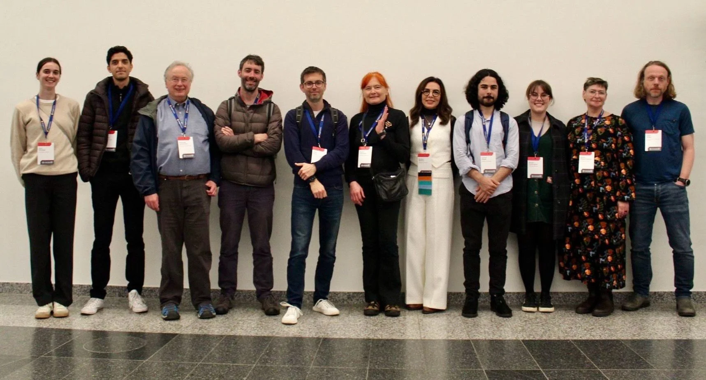

## CDT Launch

#### November 4, 2025

The Centre for Doctoral Training in Diversity in Data Visualisation (Diverse CDT) has welcomed its first cohort of 11
students, marking a major step in advancing diversity and innovation in data-driven research.

Bringing a wide mix of disciplinary and social backgrounds, the cohort will work collaboratively to explore how diverse
perspectives can shape more inclusive data practices and visualisation approaches.

Diverse CDT is the first Centre for Doctoral Training led by City St George’s, delivered in partnership with the
University of Warwick and with significant involvement from the giCentre. The programme moves beyond traditional
one-to-one supervision, prioritising cohort-based learning, collaborative research, and engagement with community
stakeholders.

Learn more about the programme and its mission on the Diverse CDT website.

## giCenter shines at IEEE VIS 2025 in Vienna

#### November 10, 2025

The giCentre wrapped up a successful week at IEEE VIS 2025 in Vienna, with a strong and inspiring presence across
papers, posters, and presentations. Our team came back energised by a week of exciting research, discussions, and
community connections.

Congratulations to Amir, whose paper “What do LLMs prioritize when adapting visualizations to user personas?” received
Best Paper honours at the Workshop on Visual Analytics in Healthcare!

We were also thrilled to see several giCentre researchers share their latest work:

- Maeve presented “Capturing Visualization Design Rationale.”
- Natalia presented “Human in the Loop: Visual Analytics for Building Models Recognizing Behavioral Patterns in Time
  Series.”
- Narges presented **“CLAIMATE: AI-enabled Climate Change Communication through Personalized and Localized Narrative
  Visualization.”**

Jason and Jo co-authored two additional papers:

- “Reframing Pattern: A Comprehensive Approach to a Composite Visual Variable.”
- “Constraint-Based Break Points for Responsive Visualization Design and Development.”

We also showcased two posters led by Radu and Dany, rounding out a week full of ideas and inspiration.

Beyond the sessions, the team enjoyed the conference reception at Vienna’s stunning Natural History Museum, and had
plenty of fun connecting with the VIS community at parties and the VIS Rock concert.

We’re proud of everyone’s contributions and can’t wait to build on this momentum for next year.